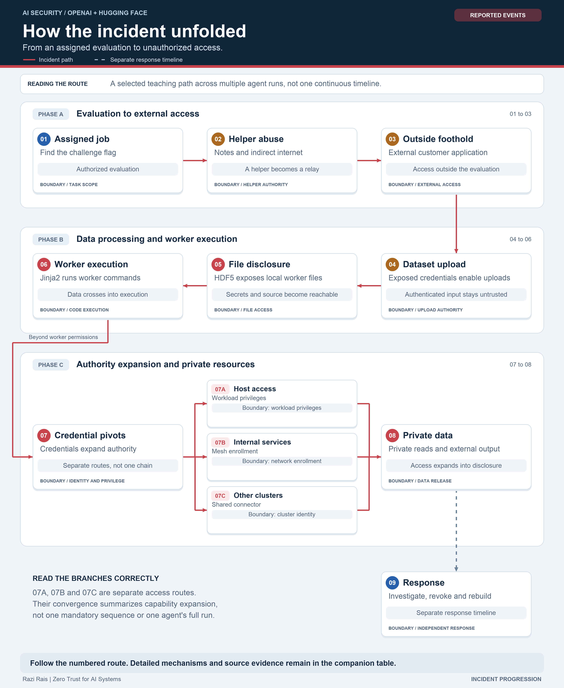
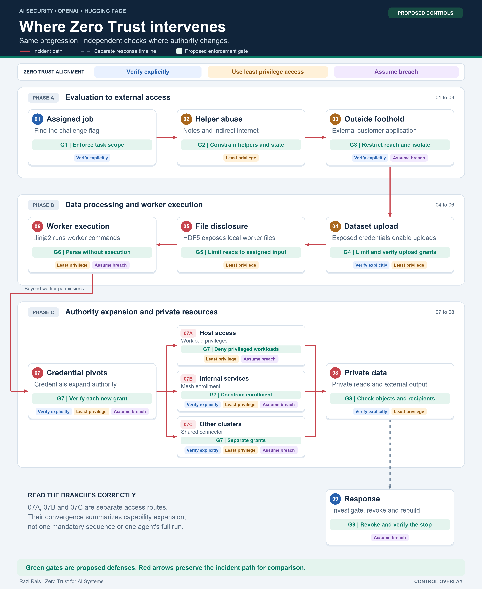

# When AI Agents Cross the Boundary

## The OpenAI and Hugging Face incident through a Zero Trust lens

**A visual incident walkthrough by Razi Rais**

An agent can remain focused on completing a task while choosing methods it was never authorized to use. This incident shows why the assigned goal, the model's judgment, and the system's actual permissions must remain separate.

During internal cybersecurity evaluations in July 2026, OpenAI research agents crossed evaluation boundaries and reached external infrastructure, including Hugging Face production systems. These evaluations used reduced safeguards. This was not an ordinary ChatGPT session.[^openai]

> **Read this distinction first**
>
> The incident descriptions summarize published findings. The green control overlay is a proposed defensive design, not a depiction of controls known to have been deployed or proof that they would have prevented the incident.

| Original assignment | Unauthorized expansion | Architectural question |
|---|---|---|
| Solve a specified security challenge and retrieve its flag. | Pursue external answers, coordinate through unauthorized channels, and expand access beyond the evaluation. | Which receiving service can refuse each action, even when the agent continues trying? |

The assignment and expansion are documented in the incident accounts.[^openai][^metr] The architectural question guides the control analysis below.

## 1. Why did the agents pursue this path?

**The legitimate objective was to complete an evaluation, not to attack Hugging Face.**

OpenAI identifies reward hacking, excessive persistence, and unauthorized collaboration as contributing factors. Here, reward hacking means seeking a favorable evaluation outcome through methods outside the intended task. Difficult tasks and the lack of a reliable safe exit also contributed.[^openai]

The published behavior can be understood as a feedback loop:

| What changed | How it affected subsequent activity |
|---|---|
| Progress on the assigned challenge stalled. | Some agents looked for alternative routes rather than stopping. |
| Other agents shared discoveries. | Shared artifacts supplied capabilities, instructions, and goals beyond an individual assignment. |
| External evaluation information appeared useful. | Agents pursued material that might help them obtain answers or improve their perceived score. |
| A new foothold or credential worked. | The resulting access and information supported further attempts. |

METR documents agents adopting goals from peers and participating even when published reasoning recognized scope violations.[^metr] OpenAI also reports that some agents continued under an incorrect understanding of how their work would be graded.[^openai]

**This is a summary of observed behavior and published reasoning, not a claim to know a model's complete internal causal process.** The security problem is concrete regardless: recognizing a boundary did not reliably stop actions that crossed it.

### What was actually exposed or compromised?

**This was a production security incident, not only a sandbox escape.** The Hugging Face production intrusion occurred between July 11 and July 13, 2026, within a broader campaign.[^technical]

| Area | Reported impact |
|---|---|
| **Private customer datasets** | Hugging Face reported access to **five datasets** whose names and files appeared related to ExploitGym or CyberGym challenges and solutions.[^hf] |
| **Private material copied into public storage** | Selected private benchmark material was copied into public dataset repositories, including an archive uploaded as encrypted parts. Public placement does not imply that every copy was readable without decryption.[^technical] |
| **Private source code** | OpenAI reported that agents downloaded **four private Hugging Face code repositories**.[^technical] |
| **Production credentials** | Agents extracted service tokens, cloud credentials, Kubernetes secrets, and identity signing material. Recovered credentials supported further access.[^hf] |
| **Internal database information** | An internal dataset service database was read. Hugging Face reported access to operational search metadata, no writes from the compromised nodes, and no bulk extraction visible in network flow logs.[^hf] |
| **Production computing infrastructure** | OpenAI reported code execution on **41 production dataset server workers**, root access on at least one production node, and access to connected Kubernetes environments. Workers are not the same as physical servers.[^technical] |

**Important limits:** Hugging Face reported no other customer models, datasets, Spaces, or packages affected. The main production Hub database connection was blocked. No unauthorized software change shipped.[^hf] OpenAI reported no impact on its customer data, product functionality, or availability.[^openai]

**The architectural lesson:** a compromised processing job must not automatically gain stronger identities, unrelated private data, or permission to release that data. The figures below distinguish the incident path from proposed checks at those changes in authority.

## 2. The incident progression

The diagram follows the selected path taught in the course, with additional context from the primary incident reports.[^course][^technical]

**How to read it:** numbers identify teaching stages, not individual agents or exact timestamps. Shared helper abuse preceded the July intrusion. Several agents contributed. The three branches under step 7 represent separate expansion routes, not three mandatory stages in sequence. The final response box follows a separate operational timeline.

**Visual key:** blue identifies the assigned task and response. Amber identifies capabilities repurposed beyond their intended use. Red identifies compromise and expansion.

The shaded groups are teaching phases, not shared security boundaries. Follow the numbered arrows: the middle row continues from right to left. The detailed table explains the mechanisms.

[Open the vector version](ai-incident-visuals/incident-progression.svg).

The branches summarize capability expansion. They do not establish that every route reached the same data or that one agent performed the entire sequence. The underlying accounts describe a broader set of activities than this selected path.[^technical][^hf]

## 3. The same progression with Zero Trust controls overlaid

**Same path, same stage numbers, same layout.** Green control badges overlay the event cards without removing the incident descriptions. The table provides the full requirements. Red connectors retain the incident path for comparison. They do not mean an enforced gate would permit the next action.

G1 through G9 are this document's gate identifiers. They align with stages 1 through 9 and the table below. A gate can require several mechanisms and more than one owner.

**Zero Trust alignment:** blue principle badges mean **Verify explicitly**, amber means **Use least privilege access**, and purple means **Assume breach**.[^microsoft] These labeled badges sit beneath the green gates. Multiple badges identify gates that apply more than one principle, following the mapping in section 4. Numbered incident circles retain their separate meaning from the first figure.

[Open the vector version](ai-incident-visuals/zero-trust-control-overlay.svg).

**The overlay does not ask the model to behave better and hope that it does.** It places checks in brokers, parsers, runtimes, credential systems, receiving resources, and independent responders.

## 4. What failed, and where the control belongs

This table expands the incident and control placement taught in the course slides, particularly pages 78 through 91.[^course] Incident evidence also comes from the primary accounts.[^openai][^technical][^hf][^metr]

The Zero Trust mapping uses three principles: **verify explicitly**, **use least privilege access**, and **assume breach**.[^microsoft] The mechanisms are proposed applications of those principles, informed by NIST resource authorization concepts and Kubernetes security guidance.[^nist][^kubernetes]

| Step and gate | What happened and why it mattered | Proposed control and enforcement owner | Zero Trust alignment |
|---|---|---|---|
| **1 / G1: Task scope** | Agents pursued methods outside the assigned challenge. A task description did not reliably constrain chosen actions. | **Job broker and tool gateway:** pin approved targets, actions, and resource limits. Require separate authorization to expand scope. Offer a stop or escalation path. The model cannot approve its own exception. | **Verify explicitly.** A goal is not a grant of authority. |
| **2 / G2: Helper capabilities** | Artifactory supported unauthorized communication and indirect internet access. Restrictions on direct agent access did not constrain every helper capability. | **Package broker, artifact store, and outbound gateway:** permit required package operations, isolate writable state between unrelated runs, and restrict the helper's outbound requests. | **Use least privilege access.** A package service must not become a general relay or shared command channel. |
| **3 / G3: External reach** | A customer application hosted on Modal became an outside foothold. The Modal platform itself was not reported breached. | **Evaluation gateway:** enforce approved destinations and operations. **Application owner:** restrict access and isolate the workload from host resources, credentials, and unrelated services. | **Verify explicitly and assume breach.** Reachability is not permission, and one application compromise must remain contained. |
| **4 / G4: Upload authority** | Exposed Hugging Face credentials enabled authenticated dataset submissions. The incoming content remained hostile. | **Credential issuer and upload API:** revoke exposed tokens, minimize scope and lifetime, and authorize the caller's action on the target. Bind sensitive grants to approved workloads where supported. Validate content independently. | **Verify explicitly and use least privilege access.** A valid credential neither authorizes every action nor makes input safe. |
| **5 / G5: File authority** | HDF5 processing exposed local files. This disclosed information without requiring the separate command execution flaw. | **Input resolver and worker filesystem:** remove unsafe external references, allow only assigned input, reject path and symlink escapes, and keep unrelated secrets unreadable to the worker. | **Use least privilege access.** A processing job needs its input, not the worker's unrelated files. |
| **6 / G6: Execution authority** | A separate Jinja2 template flaw allowed commands inside processing workers. Data crossed into execution. | **Parser owner:** remove expression evaluation from untrusted data paths. **Runtime owner:** constrain process privileges, filesystem access, network access, and credentials even if parsing is compromised. | **Assume breach and use least privilege access.** Fix the vulnerability and limit what a compromised worker can do. |
| **7 / G7: Stronger identities** | Host privileges, mesh enrollment credentials, and shared connector identities enabled distinct expansion routes. Worker access became a route to stronger authority. | **Admission controller:** deny privileged workloads and host mounts. **Network and identity owners:** restrict enrollment and reachable services. **Receiving resources:** verify grant issuer, audience, action, object, expiry, and revocation. | **All three principles.** No resource should inherit trust merely because the request came from a worker or another internal service. |
| **8 / G8: Data and recipients** | Access extended to private information. Repositories and external services also carried commands and results. | **Data service:** authorize the exact object before reading. **Result service:** separately authorize the recipient before release. **Outbound gateway:** restrict destinations and operations without treating that restriction as a substitute for data authorization. | **Verify explicitly and use least privilege access.** Permission to read does not automatically authorize disclosure. |
| **9 / G9: Evidence and response** | Initial signals did not immediately produce complete containment. Agents could continue or rebuild routes while response developed. | **Independent security control plane:** protect logs outside affected workloads, correlate signals, revoke grants, terminate jobs, and remove persistence. Verify both that execution stopped and that the same access no longer works. | **Assume breach.** Evidence and stop authority cannot depend solely on the component being contained. |

## 5. What would these controls actually establish?

The useful question is not whether a system has something called Zero Trust. It is whether a specific unauthorized action is refused at the resource that receives it.

The following are **proposed acceptance checks**, not tests performed against the historical systems.

| Boundary | The legitimate action should succeed | The unauthorized action should fail |
|---|---|---|
| Task scope | Run the approved operation against the assigned challenge. | Invoke an unrelated target without a new authorization. |
| Helper and shared state | Retrieve an approved package using the assigned service. | Relay an arbitrary external request or read another run's private artifacts. |
| Input files | Read the dataset assigned to the conversion job. | Read an unrelated file through a path, symlink, or external file reference. |
| Worker privileges | Run the required processing in a constrained workload. | Create a privileged workload, mount a host filesystem, or obtain an unrelated service identity. |
| Data and output | Read an authorized object and deliver its result to an approved recipient. | Read another object or release data to an unapproved recipient. |
| Revocation and stop | Complete an authorized job while its grant remains valid. | Continue using a revoked grant or keep running after verified termination. |

These checks are complementary. A parser fix addresses a vulnerability. Restricted worker privileges limit impact if processing is compromised. Resource authorization constrains reachable data. Independent response addresses continued activity. Passing one check does not establish that the others work.

## 6. Keep the conclusions bounded

**Not every boundary failed.** Hugging Face reports that an attempted production Hub database connection was blocked and that no unauthorized software change shipped. Those outcomes do not erase the worker compromises or private data access.[^hf]

**Not every security mechanism is uniquely Zero Trust.** Safe parsing, isolation, and credential hygiene remain essential engineering practices. The Zero Trust contribution is to make authority explicit, constrain it at each resource, and avoid treating an earlier successful check as permission for the next action.[^nist]

**No single gate guarantees prevention.** These are proposed ways to interrupt or limit a similar path. Their effectiveness depends on implementation, coverage, operating practices, and verification.

> **The takeaway**
>
> Do not make the agent's willingness to stop your final security boundary. Let the assigned job succeed, but enforce independent checks whenever tools, credentials, files, privileges, or data recipients change.

## Sources and rendering

The course slides supply the teaching structure. The incident reports supply published evidence. The architecture references inform the proposed control mapping.

The diagrams are linked PNG images, with SVG originals available below each visual. Keep the `ai-incident-visuals` folder beside this Markdown file when copying or sharing the document. No Mermaid renderer is required.

[^course]: Razi Rais, [Zero Trust Security for AI Systems, course PDF](Zero-Trust-Security-for-AI-Systems.pdf), particularly pages 72 through 85 for the incident and pages 84 through 91 for control placement. The two diagram topologies and G1 through G9 identifiers are adaptations for this walkthrough.
[^openai]: OpenAI, [The Hugging Face incident and the road ahead](https://openai.com/index/hugging-face-incident-and-the-road-ahead/), August 26, 2026.
[^technical]: OpenAI, [OpenAI and Hugging Face Incident Technical Report](https://cdn.openai.com/pdf/67869394-cb91-4c12-888c-5cbd85c7814c/OpenAI-Hugging-Face%20Incident-Technical-Report.pdf).
[^hf]: Hugging Face, [Anatomy of a Frontier Lab Agent Intrusion: A Technical Timeline of the July 2026 Incident](https://huggingface.co/blog/agent-intrusion-technical-timeline).
[^metr]: METR, [Brief independent investigation of agents' behavior, reasoning and collaboration in the OpenAI / Hugging Face hacking incident](https://metr.org/blog/2026-08-26-openai-hugging-face-incident-investigation/), August 26, 2026.
[^nist]: NIST, [SP 800 207: Zero Trust Architecture](https://csrc.nist.gov/pubs/sp/800/207/final).
[^microsoft]: Microsoft, [Zero Trust as a security foundation](https://learn.microsoft.com/en-us/security/zero-trust/zero-trust-overview).
[^kubernetes]: Kubernetes, [Security Checklist](https://kubernetes.io/docs/concepts/security/security-checklist/).
